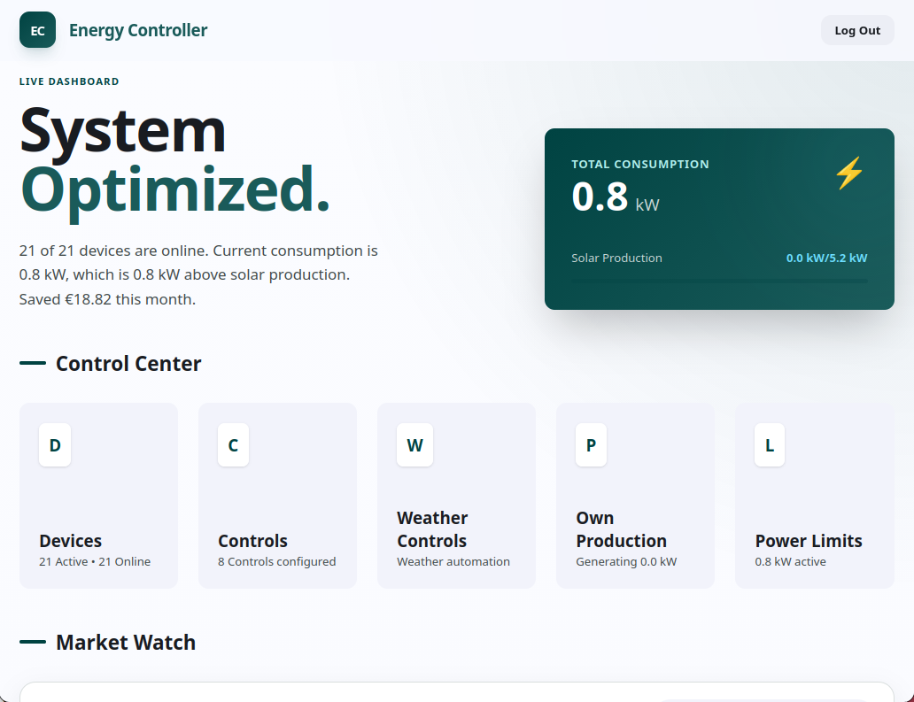
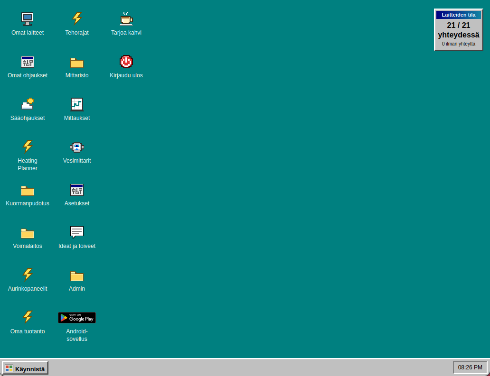
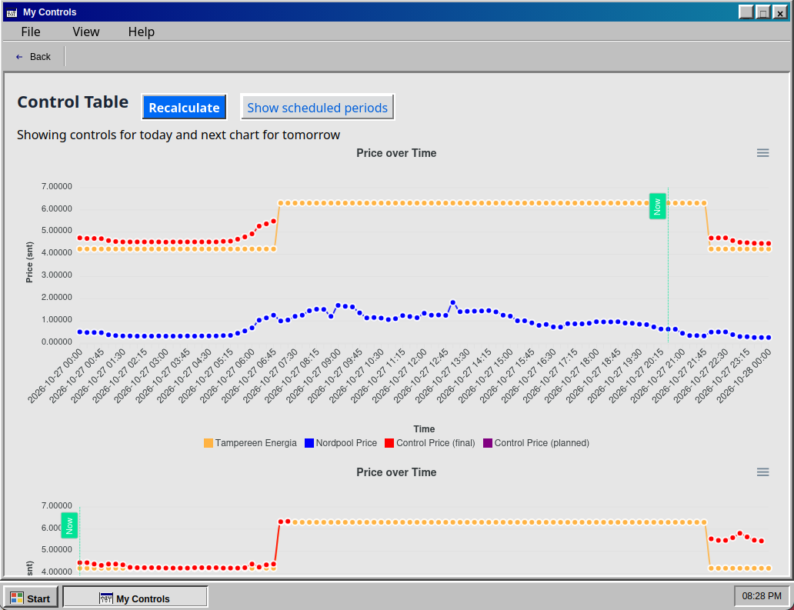
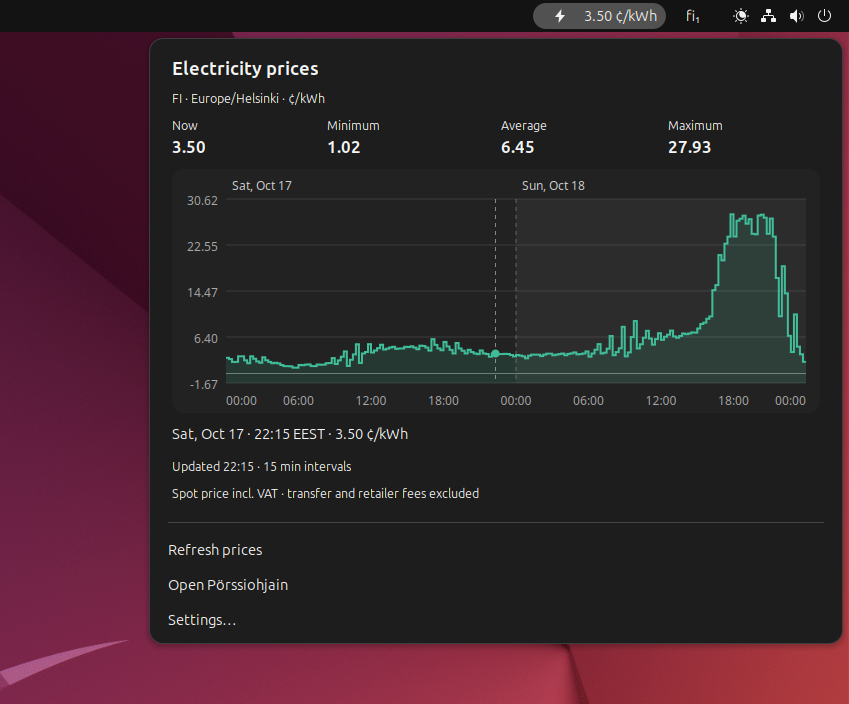
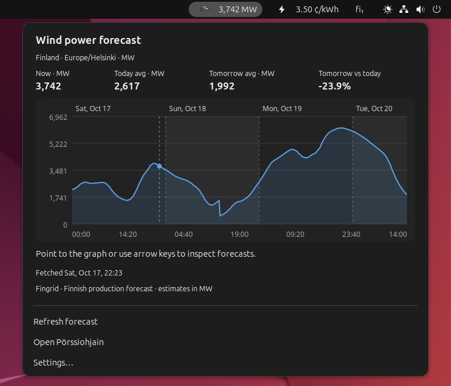

# Pörssiohjain ™

**Home energy automation, from electricity prices to device control.**

Pörssiohjain schedules compatible household devices around Nord Pool spot prices,
power consumption, your own energy production and weather forecasts. Follow your
home's energy use from a mobile dashboard or manage it through a retro desktop
in your browser.

[Open the web app](https://app.porssiohjain.fi) ·
[Get the Android app](https://play.google.com/store/apps/details?id=com.nitramite.energycontroller) ·
[Open mobile web](https://mobile.porssiohjain.fi) ·
[Visit the website](https://www.porssiohjain.fi)



*The hybrid-web dashboard, available in the Android app and mobile browser.*

## What you can do

- **Schedule around electricity prices.** Choose cheap hours, a continuous block or a schedule that considers tomorrow's
  prices. Include tax and energy/transfer contracts in the control price.
- **Respond to consumption.** Monitor current power and interval history, set power limits and shed connected loads when
  needed.
- **Use your own production.** Trigger device and heat-pump rules from SOFAR / SolarmanPV production data.
- **Plan for the weather.** Use FMI forecasts for temperature and humidity rules. Heating Planner adds floor-heating
  plans and optional wood-stove guidance in the desktop interface.
- **Connect your devices.** Integrate Shelly and other HTTP/MQTT devices, supported Toshiba and Mitsubishi heat pumps,
  and Zigbee/Tuya measurement sources.
- **See what is happening.** View device connectivity, consumption, production, measurements and water-meter history.
  Share selected measurement charts through public links.
- **And much more.** Explore Heating Planner, the solar angle planner, the Powerplant control-room board, resource
  sharing and other tools in the desktop interface.

## A retro desktop in your browser

A desktop, Start menu and taskbar bring devices, charts and settings together.
Open several feature windows, move between them and keep your current form state.

<table>
  <tr>
    <td width="50%" valign="top">
      <a href="doc/vaadin_desktop.png"></a>
      <p><strong>The desktop.</strong> Your devices and tools in one workspace.</p>
    </td>
    <td width="50%" valign="top">
      <a href="doc/vaadin_control_feature.png"></a>
      <p><strong>Price controls.</strong> Inspect prices and the control table.</p>
    </td>
  </tr>
</table>

## Android app

[**Energy Controller on Google Play**](https://play.google.com/store/apps/details?id=com.nitramite.energycontroller)
is the Android app for Pörssiohjain. It runs the [hybrid-web UI](hybrid-web/README.md)
inside the app, with mobile access to device status, power use, own production and
automation settings. The same UI is available at
[mobile.porssiohjain.fi](https://mobile.porssiohjain.fi).

The hosted service is available at [app.porssiohjain.fi](https://app.porssiohjain.fi)
and [app.energiaohjain.fi](https://app.energiaohjain.fi). These, the mobile-web
address above and [www.porssiohjain.fi](https://www.porssiohjain.fi) are the official
Pörssiohjain service domains.

## GNOME desktop indicators

Keep electricity prices and Finland's wind-power production forecast in your
desktop's top bar, with interactive graphs in the dropdown menus. Both indicators
can run together, and neither requires an account or API token.

<table>
  <tr>
    <td width="50%" valign="top">
      <a href="doc/gnome_electricity_prices.png"></a>
      <p><strong><a href="gnome/extensions/electricity-prices/README.md">Electricity prices</a></strong><br>Current spot price and today's/tomorrow's price chart.</p>
    </td>
    <td width="50%" valign="top">
      <a href="doc/gnome_wind_forecast.png"></a>
      <p><strong><a href="gnome/extensions/wind-forecast/README.md">Wind-power forecast</a></strong><br>Finnish production forecasts in MW and daily averages.</p>
    </td>
  </tr>
</table>

Tested on **GNOME Shell 46 / Ubuntu 24.04**.
[Installation instructions](gnome/README.md) ·
[Download ready-to-install packages](https://github.com/norkator/porssiohjain/releases/tag/gnome-extensions-latest)

## Documentation

| Looking for…                             | Start here                                            |
|------------------------------------------|-------------------------------------------------------|
| Relay control or power-meter reporting   | [Shelly setup](doc/shelly.md)                         |
| Application configuration                | [Environment variables](doc/environment-variables.md) |
| How standard device control output works | [Control output flow](doc/control-output-flow.md)     |
| Device claiming, MQTT profiles and OTA   | [Provisioning guide](PROVISIONING.md)                 |
| Feature guides and integration details   | [Documentation index](doc/README.md)                  |

## Development

The backend uses **Java 21, Spring Boot, Vaadin and PostgreSQL**. The mobile UI uses **React and TypeScript**; the GNOME
indicators use **GJS and Rust**.

Build and run the backend tests with the repository's Gradle wrapper:

```sh
./gradlew compileJava test
```

See [hybrid-web development](hybrid-web/README.md) and
[GNOME development](gnome/README.md#build-and-verify) for the other clients.
Current backend configuration is defined in
[application.properties](src/main/resources/application.properties).

## Support the project

If Pörssiohjain is useful to you, you can
[buy the developer a coffee](https://buymeacoffee.com/norkator).

## License

This project is licensed under the Pörssiohjain Personal Use License v1.0.

Private individuals may self-host it for their own household use. Commercial use, resale, managed hosting, customer
installations, or offering it as a service to third parties requires a separate written commercial license.

See the LICENSE file for details.
