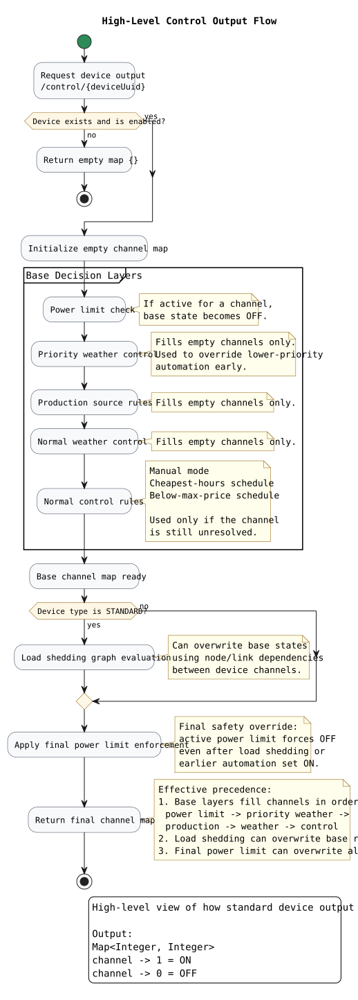

# Standard device output flow

This diagram gives a high-level overview of how Pörssiohjain produces control
output for standard devices.

## Editable diagrams

- [High-level control output flow](control-output-high-level.puml)
- [Detailed standard device control output flow](control-output-flow.puml)
- [PlantUML documentation](README-diagrams.md)
